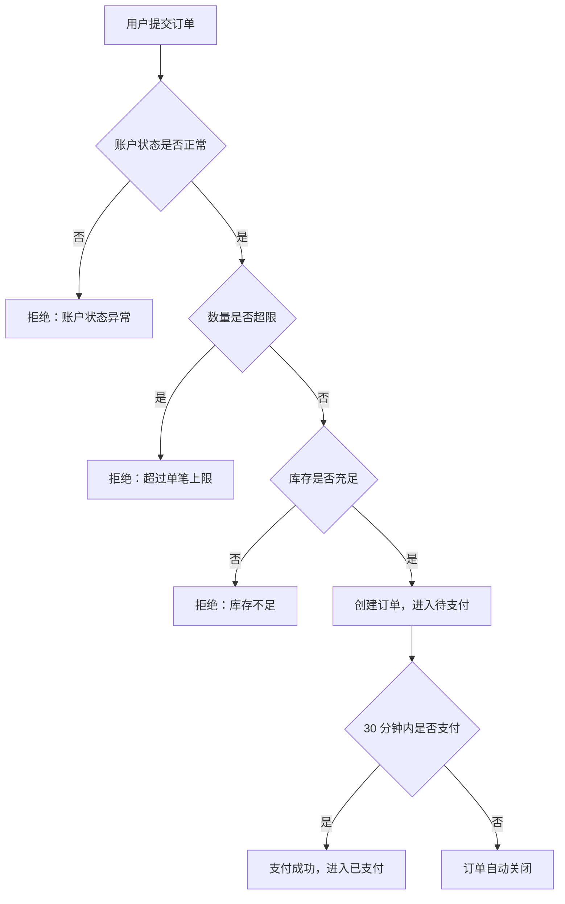
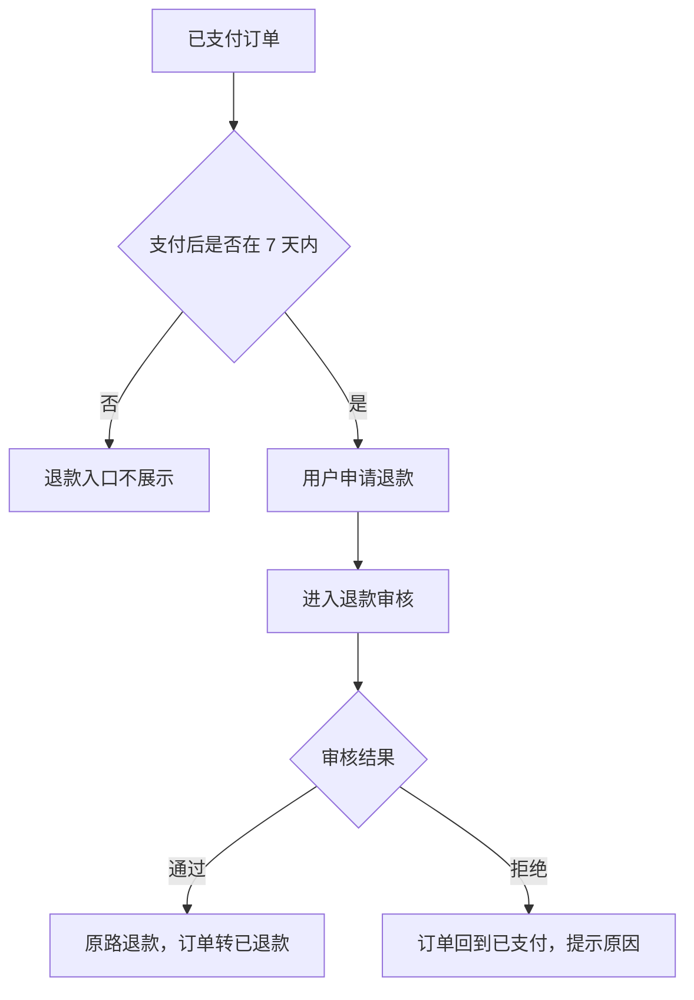
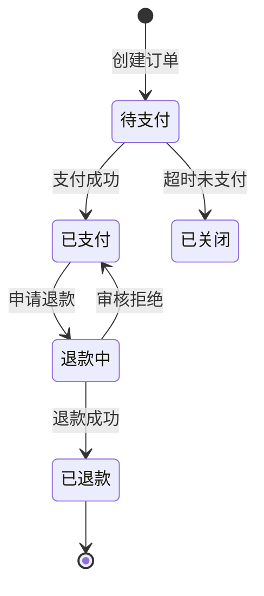
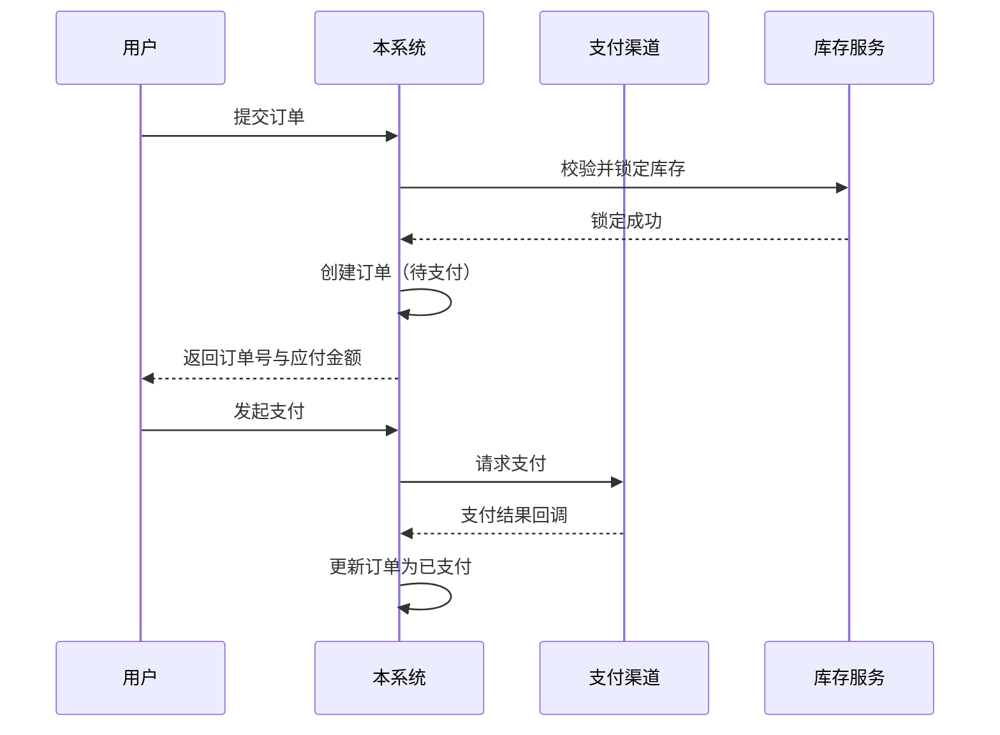
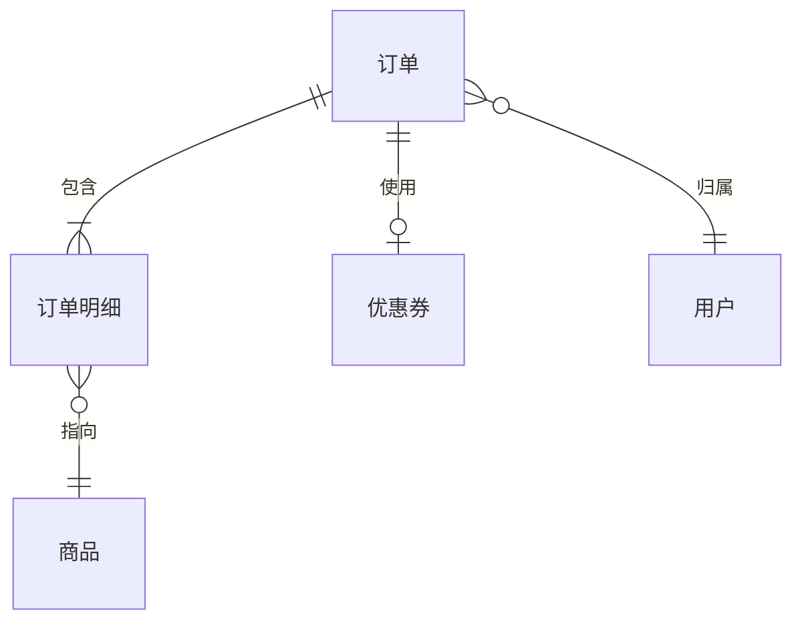
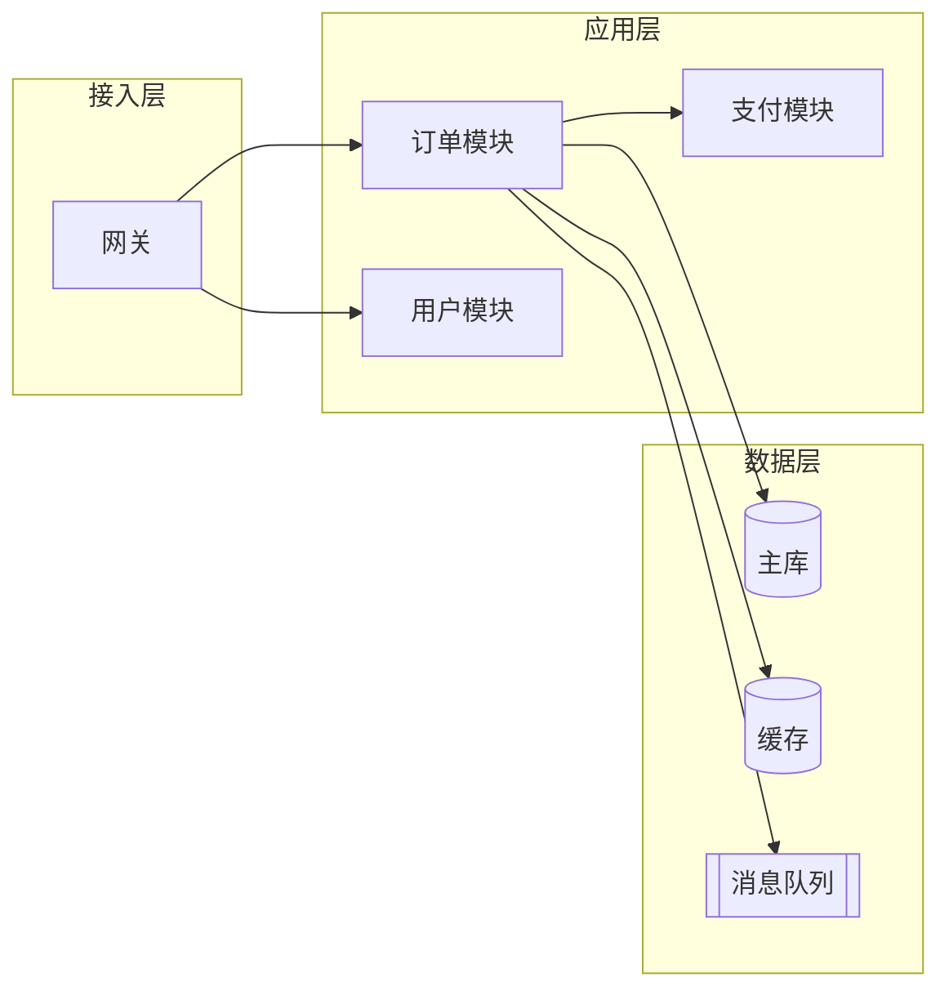

# 表达格式

统一使用下列表格与图。编号一旦分配不变更，后续章节引用编号。

---

## 决策表

| 编号 | 条件一 | 条件二 | 条件三 | 结果 | 用户可见表现 |
|---|---|---|---|---|---|
| BR-01 | 账户冻结 | — | — | 拒绝创建 | 提示"账户状态异常，请联系客服" |
| BR-02 | 账户正常 | 超出限额 | — | 拒绝创建 | 提示"单笔数量不能超过 {上限} 件" |
| BR-03 | 账户正常 | 未超限 | 库存充足 | 创建成功 | 跳转支付页 |
| BR-04 | 账户正常 | 未超限 | 库存不足 | 拒绝创建 | 提示"商品库存不足" |

要求：写全所有取值，含"其他/未配置"落入哪支；"用户可见表现"必填。

---

## 判断顺序表

| 顺序 | 校验内容 | 不通过时提示 | 说明 |
|---|---|---|---|
| 1 | 登录状态 | "请先登录" | 未登录不进入后续校验 |
| 2 | 账户状态 | "账户状态异常…" | 冻结优先拦截 |
| 3 | 参数合法性 | "数量不能为空" | |
| 4 | 限额 | "单笔数量不能超过…" | |

---

## 状态迁移表

| 编号 | 当前状态 | 触发事件 | 触发方式 | 附加条件 | 目标状态 | 结果与提示 |
|---|---|---|---|---|---|---|
| TR-01 | 待支付 | 支付成功 | 用户操作 | — | 已支付 | 提示"支付成功" |
| TR-02 | 待支付 | 超时未支付 | 定时任务 | 超过 30 分钟 | 已关闭 | 无提示 |
| TR-03 | 已支付 | 申请退款 | 用户操作 | 支付后 7 天内 | 退款中 | 进入退款审核 |

触发方式：用户操作 / 定时任务 / 外部回调 / 人工处理 / 批量导入。

---

## 非法迁移表（必写）

| 当前状态 | 尝试操作 | 系统表现 | 提示原文 |
|---|---|---|---|
| 已关闭 | 支付 | 拒绝 | "订单已关闭，无法支付" |
| 已退款 | 再次退款 | 入口不展示 | — |

区分"入口不展示""按钮不可用""可点击但报错"三种表现。

---

## 业务规则表

| 编号 | 规则 | 适用条件 | 判定依据 | 违反时表现 | 来源 |
|---|---|---|---|---|---|
| R-01 | 单笔最多 5 件 | 所有下单 | 数量 ≤ 5 | 提示"单笔数量不能超过 5 件" | 已确认 |

---

## 公式表

| 编号 | 名称 | 公式 | 变量说明 | 精度与舍入 | 边界处理 | 算例 |
|---|---|---|---|---|---|---|
| FML-01 | 应付金额 | 应付 = 商品金额 − 优惠金额 + 运费 | 商品金额=单价×数量；优惠可为 0 | 保留 2 位，四舍五入，最后一步统一舍入 | 优惠大于商品金额时应付为 0，不为负 | 单价 9.99×3=29.97；29.97−5+8=32.97 |

算例要求：常规例 + 边界例；写出中间过程；连续计算时注明每步是否舍入。

---

## 配置项表

| 编号 | 配置项（业务名） | 配置项标识 | 默认值 | 取值范围 | 影响功能 | 影响分支 | 生效方式 | 环境差异 |
|---|---|---|---|---|---|---|---|---|
| CFG-01 | 单笔下单上限 | order.max.qty | 5 | 1~50 整数 | 下单 | 超过则拒绝 | 实时生效 | 测试环境为 2 |

---

## 时效表

| 编号 | 项目 | 计时起点 | 时长 | 到期判定 | 到期表现 | 触发方式 |
|---|---|---|---|---|---|---|
| TM-01 | 支付超时 | 订单创建时刻 | 30 分钟 | 超过 30 分钟关闭（第 30 分钟整仍可支付） | 订单自动关闭 | 定时任务每分钟检查 |

---

## 接口清单表

| 路径 | 方法 | 用途 | 所属功能 | 鉴权 | 幂等 | 限流 | 超时 |
|---|---|---|---|---|---|---|---|
| /api/order/create | POST | 创建订单 | 下单 | 登录态 | requestId | 10 次/秒/用户 | 3 秒 |

---

## 接口字段表

请求：

| 字段（业务名） | 真实字段 | 类型 | 必填 | 说明 | 校验规则 |
|---|---|---|---|---|---|
| 商品编号 | productId | 长整数 | 是 | 待购商品 | 必须为已上架商品 |
| 数量 | quantity | 整数 | 是 | 购买件数 | 1~5，可配置 |

响应：

| 字段（业务名） | 真实字段 | 类型 | 说明 |
|---|---|---|---|
| 订单号 | orderNo | 字符串 | 本次创建的订单号 |

---

## 错误码表

| 错误码 | 含义 | 触发条件 | 建议处理 |
|---|---|---|---|
| 40001 | 参数错误 | 必填缺失或格式不符 | 修正后重试 |
| 40901 | 重复提交 | 同一幂等键重复请求 | 查询首次结果 |

---

## 表结构表

订单表（`t_order`）：

| 字段（业务名） | 真实字段 | 类型 | 必填 | 默认值 | 说明 |
|---|---|---|---|---|---|
| 订单号 | order_no | varchar(32) | 是 | — | 全局唯一 |
| 订单状态 | order_status | tinyint | 是 | 10 | 10 待支付 / 20 已支付 / 30 已关闭 |
| 应付金额 | pay_amount | decimal(12,2) | 是 | 0.00 | 单位：元 |

另附：主键、唯一约束（及其业务含义）、索引（及对应查询场景）。

---

## 缓存与消息表

| 缓存内容 | 键规范 | 过期时间 | 失效时机 | 不一致窗口 | 降级表现 |
|---|---|---|---|---|---|
| 订单详情 | order:detail:{订单号} | 30 分钟 | 状态变更时 | ≤ 30 分钟 | 直接查库 |

| 消息主题 | 触发时机 | 消息内容 | 消费方业务 | 幂等方式 | 失败处理 |
|---|---|---|---|---|---|
| 订单创建成功 | 订单落库后 | 订单号、用户、金额 | 通知下游发货 | 按订单号去重 | 重试 3 次后死信 |

---

## 提示文案表

| 编号 | 场景 | 触发条件 | 提示原文 | 类型 | 用户应对 | 可否重试 |
|---|---|---|---|---|---|---|
| MSG-01 | 库存不足 | 库存小于购买数量 | 商品库存不足 | 拦截 | 减少数量或稍后再试 | 是 |

类型：拦截 / 警告 / 确认 / 告知。

---

## 枚举字典表

| 字段（业务名） | 取值 | 含义 | 用户可见名称 | 该值下可执行操作 |
|---|---|---|---|---|
| 订单状态 | 10 | 待支付 | 待支付 | 支付、取消 |
| 订单状态 | 20 | 已支付 | 已支付 | 申请退款 |

---

## Mermaid 模板

### 业务流程图（主干）

### 逆向流程图

### 状态机图

### 接口时序图（跨系统）

### ER 图（实体用业务名）

### 架构图（节点为系统/模块）

图规则：节点用业务动作或系统/模块名；分支条件写连线标签；每张图配文字说明；不出现类名、方法名；Mermaid 语法须可渲染。
